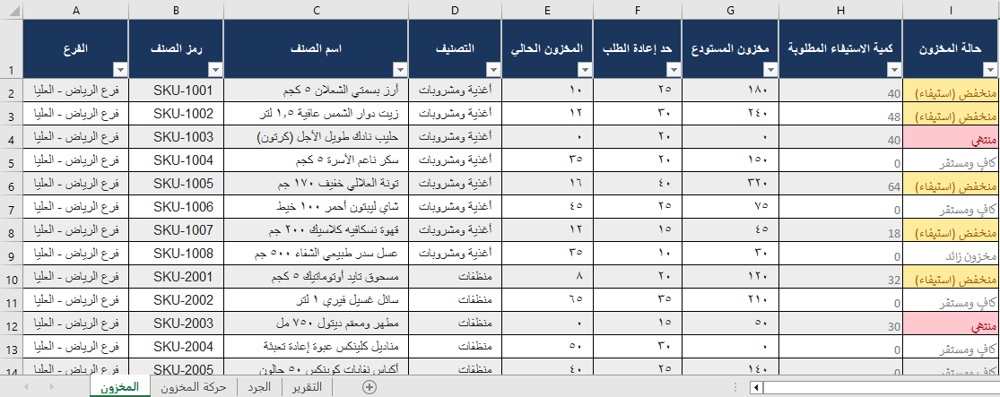
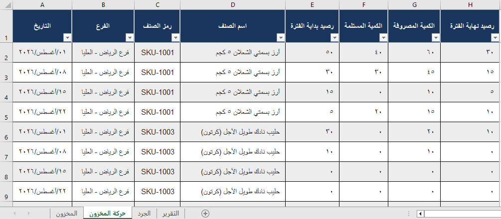
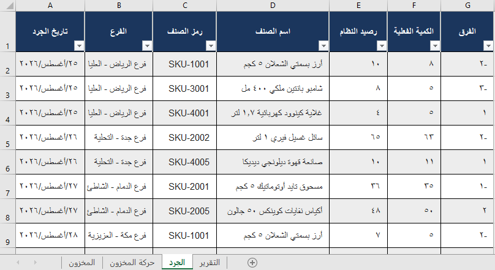
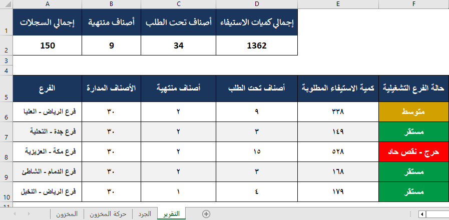

# نموذج مراقبة المخزون وإدارة احتياجات إعادة الطلب

## نبذة عن المشروع

مشروع باستخدام Microsoft Excel لإدارة ومراقبة المخزون في عدة فروع، وتتبع حركة الأصناف، ومقارنة أرصدة النظام بنتائج الجرد الفعلي، وتحديد احتياجات إعادة الطلب.

يهدف المشروع إلى توضيح كيفية استخدام Excel لتحسين الرقابة على المخزون، واكتشاف حالات النفاد والنقص، وتنظيم عمليات إعادة التوريد، ودعم اتخاذ القرارات التشغيلية.

## أهداف المشروع

- مراقبة مستويات المخزون في الفروع المختلفة.
- تحديد الأصناف التي نفدت أو وصلت إلى حد إعادة الطلب.
- حساب كميات الاستيفاء المطلوبة.
- تتبع الكميات المستلمة والمنصرفة وأرصدة المخزون.
- مقارنة أرصدة النظام بنتائج الجرد الفعلي.
- إعداد تقارير ملخصة لحالة المخزون في الفروع.

## مكونات المشروع

### 1. ورقة المخزون (Inventory)

تعرض هذه الورقة البيانات الأساسية للأصناف، بما يشمل رموز الأصناف وأسماءها وتصنيفاتها ومستويات المخزون وحدود إعادة الطلب وكميات الاستيفاء المطلوبة.

تساعد هذه الورقة على تحديد حالة كل صنف واكتشاف الأصناف التي تحتاج إلى إعادة التوريد.

### 2. ورقة حركة المخزون (Inventory Movement)

تسجل هذه الورقة حركة الأصناف، بما يشمل رصيد بداية الفترة والكميات المستلمة والمنصرفة ورصيد نهاية الفترة.

يُحسب رصيد نهاية الفترة باستخدام المعادلة التالية:

`رصيد نهاية الفترة = رصيد بداية الفترة + الكمية المستلمة - الكمية المنصرفة`

### 3. ورقة الجرد (Stocktaking)

تُستخدم هذه الورقة لمقارنة رصيد النظام بالكمية الفعلية للأصناف وتحديد الفروقات التي قد تستدعي المراجعة.

يُحسب الفرق وفقًا للمعادلة التالية:

`الفرق = الكمية الفعلية - رصيد النظام`

تفسير نتائج الجرد:

- **الفرق السالب:** الكمية الفعلية أقل من رصيد النظام.
- **الفرق الموجب:** الكمية الفعلية أكبر من رصيد النظام.
- **الفرق الصفري:** تطابق الكمية الفعلية مع رصيد النظام.

### 4. ورقة التقرير (Inventory Report)

تعرض هذه الورقة ملخصًا لحالة المخزون واحتياجات إعادة الطلب على مستوى الفروع، بما يشمل عدد الأصناف المنتهية والأصناف التي تحتاج إلى إعادة الطلب وكميات الاستيفاء المطلوبة.

يساعد التقرير على تحديد أولويات المتابعة التشغيلية ومراجعة احتياجات المخزون في الفروع.
